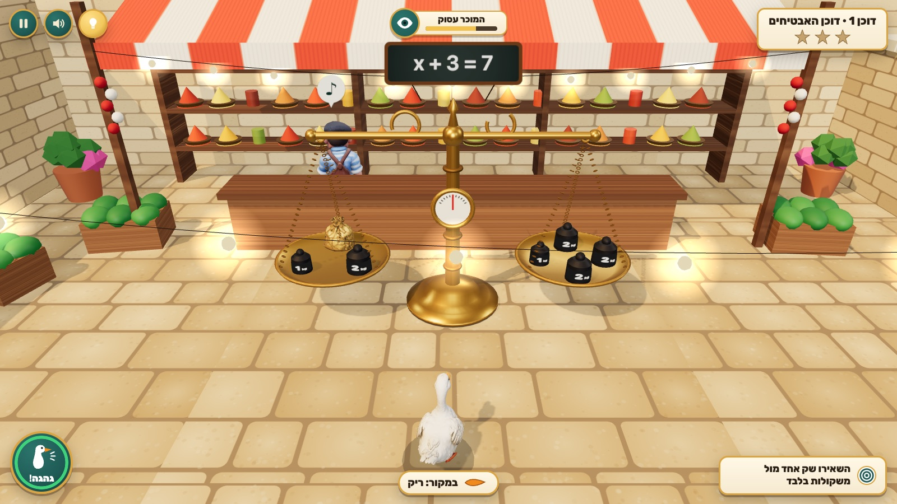

# Goose on the Scale — אווז על המאזניים

A comic 3D stealth puzzle for Hebrew-speaking grade-8 students. A mischievous goose sneaks around a Jerusalem-style shuk where every stall's brass two-pan scale **is a linear equation**: identical sacks are the unknown `x`, iron blocks are numbers, helium balloons are −1. Tip a scale while the vendor is watching and you get shooed back to the last balanced state. The only safe way to mess with a scale is to do the same thing to both pans, fast, while the vendor's back is turned. Leave one sack alone against plain weights and you've found `x`; then load the seesaw with exactly the weight of n sacks and catapult over the wall to the next stall.

- 7 stalls + a bonus (no solution / infinitely many solutions), about 6–10 minutes.
- Three.js scene with Tripo-generated goose, vendor (rigged, 4 animation clips), sack and spice jar; everything mathematical is exact procedural geometry.
- Hebrew RTL UI, formulas in LTR isolates, keyboard + mouse + touch.
- Design reference mockups (ChatGPT image generation) in `docs/mockups/`.

## Run

```bash
npm install
npm run dev        # http://localhost:5179
npm test           # rules, solver and vendor tests (node:test via tsx)
npm run build      # static build in dist/ (relative base, works offline)
npm run capture    # with the dev server running: real-Chrome smoke run + screenshots in docs/screenshots/
```



URL flags: `?stall=3` start at a stall, `?all` unlock every stall in the menus, `?touch` force the touch layout, `?debug` include hidden values in `render_game_to_text()`, `?test` don't auto-pause when the tab is hidden.

## Controls

| Action | Keyboard | Mouse / touch |
|---|---|---|
| Waddle | WASD / arrows | on-screen joystick (touch); drag to swing the camera |
| Take / put (context shown in the prompt chip) | E or Enter | click an item or a pan; big "קח / הנח" button |
| Honk (distracts the vendor if you're beside/behind him) | Q | "גהגה!" button |
| Flap-hop / launch from the seesaw | Space | "קפיצה" button |
| Chalk tag hint (logged) | H | 💡 button |
| Pause / mute / restart stall | Esc or P / M / R | ⏸ / 🔊 buttons, pause menu |

## How it plays

- **Vendor attention**: ♪ humming with his back turned (safe) → **?** head-turn wind-up (~1.3 s) → 👁 looking (≈2.5 s). Caught = vendor looking while the scale is tipped. The top meter shows the same state in words and a timer bar (never color alone).
- **Honk** from beside/behind the vendor and he turns toward the noise, away from the scale (a green ✓ on the honk button says "this spot works"). Honking from the scale side only makes him turn toward you — and the scale.
- **Equivalent moves**: take the same thing off both pans; add the same thing from the supply crate; the **change box** turns a 10/5/2 block into a bundle with the same total; the **share board ÷k** keeps one of k equal groups on each pan (it explains why it jams: odd sack count, total not divisible, or a block too big for the group); a 1 kg block dropped next to a balloon ties a **zero pair** that weighs 0.
- **Getting caught** resets the stall to the last balanced moment and explains, per pan, what changed and which side got heavier (in terms of `x` when sacks moved, so it never leaks the answer).
- **Stars**: found `x` · never caught · first seesaw launch exact.

## Code map

| File | Role |
|---|---|
| `src/rules.ts` | pure balance rules: items, pans, grab/drop/change/share, zero pairs, solved check, classify (bonus), equation string |
| `src/vendor.ts` | pure attention cycle, honk geometry |
| `src/levels.ts` | the 8 authored stalls |
| `src/solver.ts` | BFS proving each stall has a safe solution (≤ 2 unbalanced actions in a row) |
| `src/game.ts` | controller: goose movement/collision, interactions, catching/reset, seesaw, bonus, `textState()` |
| `src/view.ts`, `src/world.ts`, `src/textures.ts` | Three.js rendering, procedural shuk/scale/props, canvas textures |
| `src/main.ts`, `src/style.css`, `index.html` | loop, HUD, menus, touch, test hooks (`render_game_to_text`, `advanceTime`, `__debug`) |
| `scripts/optimize-model.mjs` | Tripo GLB → web (sloppy simplify, WebP, meshopt) |

See `ASSETS.md`, `CURRICULUM.md`, `PLAYTEST.md`, `progress.md`.
